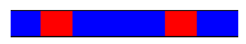
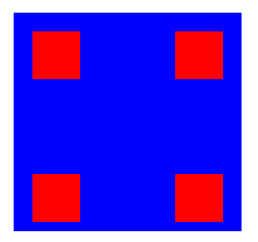
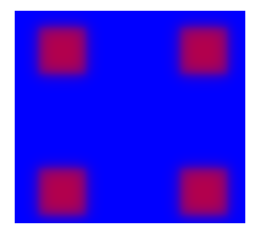

# Équation de la chaleur — Simulation 1D & 2D

Résolution numérique de l'équation de la chaleur sur une **barre (1D)** et une **plaque (2D)**, avec visualisation en temps réel grâce à **SDL2**. Le programme compare le comportement thermique de quatre matériaux : cuivre, fer, verre et polystyrène.

> Projet de Programmation Avancée — ENSIIE, 2ᵉ année (2025/2026)
> Réalisé par **Sara HADOUANI** et **Mariam SYLLA**


---

## Modèle physique

L'évolution de la température $u$ est décrite par :

$$\rho c \frac{\partial u}{\partial t} = \lambda \Delta u + F$$

| Symbole | Signification |
|---|---|
| $u(x,t)$ | température |
| $\lambda$ | conductivité thermique |
| $\rho$ | masse volumique |
| $c$ | capacité thermique massique |
| $F$ | terme source de chaleur |

La vitesse de propagation dépend de la **diffusivité thermique** $\alpha = \lambda / (\rho c)$ : élevée pour les métaux (diffusion rapide), faible pour les isolants (chaleur localisée).

- **Condition initiale :** température uniforme dans tout le domaine
- **Conditions aux limites :** Dirichlet (température fixée aux bords)

## Méthodes numériques

- **Espace :** différences finies centrées d'ordre 2 sur un maillage uniforme
- **Temps :** schéma d'**Euler implicite**, inconditionnellement stable
- **1D :** système tridiagonal résolu par l'**algorithme de Thomas** en $O(N)$
- **2D :** schéma **ADI** (*Alternating Direction Implicit*) : chaque pas $\Delta t$ est découpé en deux demi-pas, implicite en $x$ puis en $y$. 

Les paramètres numériques (maillage, pas de temps, durée) sont imposés par l'énoncé et identiques pour tous les matériaux, pour que la comparaison soit cohérente.

## Structure du projet

| Fichier | Rôle |
|---|---|
| `materiau.h` | Structure `Materiau` (nom, conductivité, masse volumique, chaleur massique) |
| `solveur.h/.cpp` | Algorithme de Thomas pour résoudre les systèmes tridiagonaux $AX = B$ |
| `sdl.h/.cpp` | Classe `Sdl` qui encapsule SDL2 : fenêtre, renderer, affichage (`sim_barre`, `sim_plaque`), contrôle (`wait`, `continuer`) |
| `barre.h/.cpp` | Simulation 1D (`resoudre_chaleur`) |
| `plaque.h/.cpp` | Simulation 2D (`resoudre_chaleur_plaque`) |
| `interface.h/.cpp` | Interface en ligne de commande pour choisir le matériau |

## Installation

### Prérequis

- Un compilateur C++ (`g++`)
- **SDL2** et `pkg-config`

```bash
# Debian / Ubuntu
sudo apt install g++ libsdl2-dev pkg-config

### Compilation

```bash
g++ -g -Wall -Wextra -o projet *.cpp `pkg-config --cflags --libs sdl2`
```

## Utilisation

```bash
./projet
```

Le programme demande de choisir un matériau :

```
1 - Cuivre
2 - Fer
3 - Verre
4 - Polystyrène
```

Il lance ensuite automatiquement deux simulations à la suite : **la barre 1D**, puis **la plaque 2D**. La température est affichée avec un dégradé du **bleu (froid)** au **rouge (chaud)**. Il suffit de fermer la fenêtre pour passer à la suite ou quitter.

## Résultats

| | Métaux (cuivre, fer) | Isolants (verre, polystyrène) |
|---|---|---|
| **Barre 1D** | La chaleur se propage vite et la température s'homogénéise | Les zones chaudes restent localisées, les gradients persistent |
| **Plaque 2D** | Propagation radiale en cercles concentriques (bien visible au-delà de 16 s de simulation) | Chaleur confinée autour de la source : zones très chaudes à côté de zones très froides |

<p align="center">
  
  
  
  
</p>

## Limites et pistes d'amélioration

**Limites**
- Les bords sont à température fixe, alors qu'en réalité il y a des pertes thermiques vers l'extérieur.
- La plaque est supposée d'épaisseur nulle : pas de transfert dans la profondeur (pas de 3D).

**Pistes**
- Matériaux composites (ex. une couche de métal protégée par un isolant), pour simuler l'isolation de bâtiments.
- Interface graphique interactive (boutons, curseurs) pour modifier les propriétés en temps réel.

## Auteures

- **Sara HADOUANI**
- **Mariam SYLLA**

